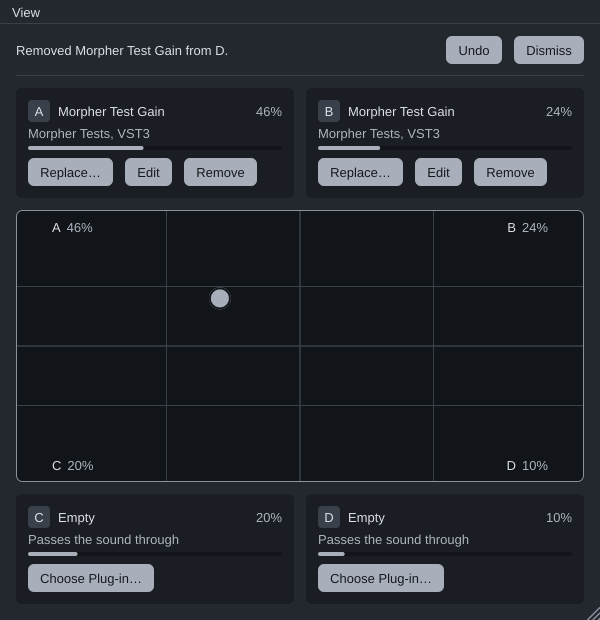

# Morpher

A VST3, CLAP and AU plug-in that holds four plug-ins, one in each corner of a
square, and mixes them by where you are on it. Drag toward a corner to hear
more of it; automate the square to move between four sounds over a song.



## Using it

1. **Choose Plug-in…** under a corner. Recent plug-ins and the ones installed
   in the usual VST3 folders are listed; **Choose File…** finds one anywhere.
2. Drag the handle on the square. Each corner's share shows by its letter and
   in its panel. The arrow keys move it too (Shift for small steps).
3. **Edit** opens a plug-in's own window. **Replace…** and **Remove** can be
   undone from the message at the top.

Good to know:

- An empty corner passes the sound through, so one plug-in in A is a dry/wet
  control, and a new Morpher changes nothing.
- A new Morpher starts in corner A: a plug-in loaded there is heard in full.
- Every corner is lined up in time with the slowest plug-in, and Morpher tells
  your DAW its delay.
- All four plug-ins run all the time, heard or not, so tails and timing are
  right as you move. Morpher costs what its four plug-ins cost together.
- The DAW can automate the square as **Morph X** and **Morph Y**.
- **View → Text Size** makes everything larger, up to 200% (Cmd+= and Cmd+-).
- If a project opens without one of its plug-ins, the corner keeps its
  settings until the plug-in is back.
- Instruments work in a corner too. Morpher is an effect that accepts MIDI, so
  put it where your DAW sends MIDI to effects.

Morpher hosts VST3 plug-ins only. It mixes their sound; it doesn't blend
their settings ([why](docs/decisions/0003-the-morph-mixes-sound-not-settings.md)).

## Download

Each push builds Morpher for macOS (Apple silicon and Intel), Windows and
Linux: see the **Build and test** workflow's artifacts on GitHub. The Mac
build isn't signed or notarised; if macOS refuses it, run
`xattr -dr com.apple.quarantine` on the plug-in.

Put `Morpher.vst3` in your VST3 folder, `Morpher.clap` in your CLAP folder,
and on a Mac `Morpher.component` in `~/Library/Audio/Plug-Ins/Components`.

## Building

Needs CMake 3.22 or later and a C++17 compiler (Xcode, Visual Studio 2022, or
GCC/Clang on Linux with [JUCE's packages](https://github.com/juce-framework/JUCE/blob/master/docs/Linux%20Dependencies.md)).
JUCE 9.0.4 and clap-juce-extensions are fetched at fixed versions.

```bash
cmake -S . -B build -DCMAKE_BUILD_TYPE=Release
```

```bash
cmake --build build --config Release --target Morpher_VST3 Morpher_CLAP
```

On a Mac, add `Morpher_AU`, and `-DCMAKE_OSX_ARCHITECTURES="arm64;x86_64"` to
the first command for a universal build. The plug-ins land in
`build/Morpher_artefacts/Release/`.

## Tests

```bash
cmake --build build --target MorpherTests
```

Then run `build/tests/MorpherTests_artefacts/<config>/MorpherTests`. On a
Linux machine without a screen, `tests/run-headless.sh` runs it on a virtual
display (it needs `xvfb` and `openbox`). The tests build a small VST3 of their
own and load it into Morpher's corners, then check the window against
Apple's guidelines at every text size. `MorpherTests --screenshots <folder>`
draws the window to PNGs.

## How it's made

- `src/MorphMath.h`: each corner's share of the sound at a point.
- `src/Slot.*`: one corner: its plug-in, run on the audio thread, and its delay.
- `src/MorpherProcessor.*`: the four corners, the mix, latency, saving and Undo.
- `src/ui/`: the window, in the house scheme (`src/Theme.h`).

The reasons behind the choices are in [docs/decisions](docs/decisions). The
colours are in [docs/COLOUR.md](docs/COLOUR.md), and the review against
Apple's Human Interface Guidelines in
[docs/apple-hig-review.md](docs/apple-hig-review.md).

## Licence

GPLv3 (see `LICENSE`). Built with [JUCE](https://juce.com) under the AGPLv3
and [clap-juce-extensions](https://github.com/free-audio/clap-juce-extensions)
(MIT). VST is a trademark of Steinberg Media Technologies GmbH.
